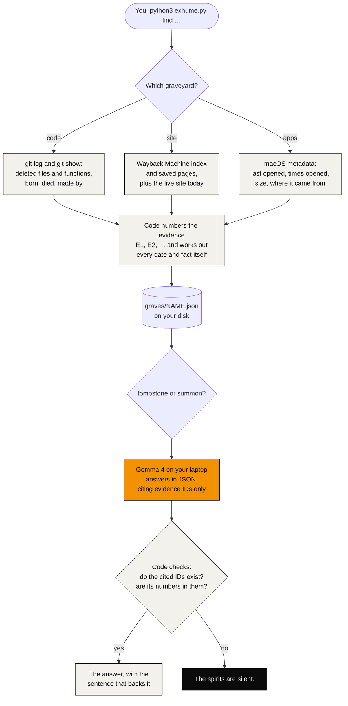
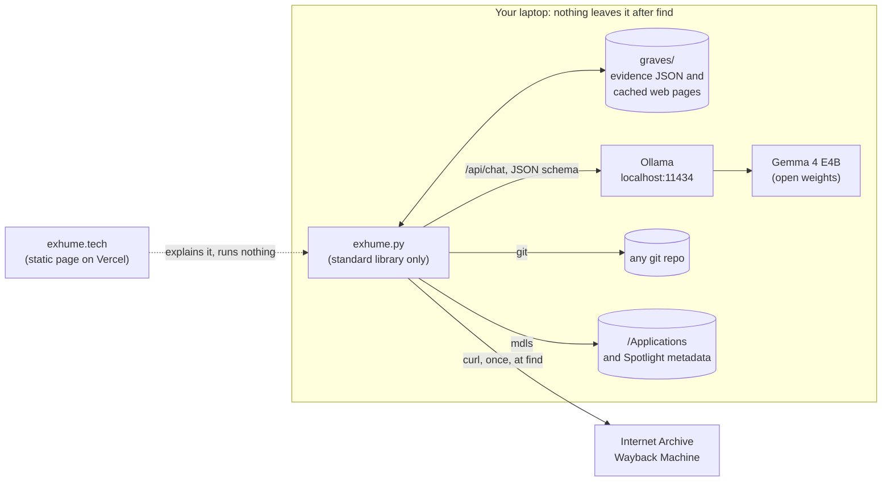

# Exhume

Talk to the dead, on your own laptop.

Exhume is a medium that runs Gemma 4 locally through Ollama. It lets you question three kinds of dead things: code deleted from a git repository, websites that now live only in the Wayback Machine, and Mac apps you stopped opening.

[](https://exhume.tech/demo.mp4)

**Live:** [exhume.tech](https://exhume.tech) · **Code:** this repo · **Agent session:** [Entire checkpoint](#how-it-was-built)

Every graveyard works the same way:

1. **Find the dead.** Code collects the evidence, numbers each piece (E1, E2, …) and works out the facts itself: dates, commits, authors, how long it lived.
2. **Tombstone.** Gemma writes the cause of death and an epitaph, from the evidence only.
3. **Summon.** Ask it anything. Every answer cites the evidence it rests on. When the evidence doesn't say, the answer is "The spirits are silent."

> **Verify in 30 seconds**
> | | |
> |---|---|
> | **Model** | **Gemma 4 E4B** (`gemma4:e4b`), run locally with Ollama. Licence: [Apache 2.0](https://ai.google.dev/gemma/apache_2). [`exhume.py` line 23](exhume.py#L23) |
> | **Where Gemma is called** | `ask()` in [`exhume.py` line 34](exhume.py#L34): one call to Ollama's `/api/chat`, JSON out, temperature 0.2, fixed seed. Used by `tombstone()` ([line 510](exhume.py#L510)) and `summon()` ([line 536](exhume.py#L536)) |
> | **Harness** | Plain code after every answer: `guard()` ([line 81](exhume.py#L81)) drops citations that don't exist, `numbers_ok()` ([line 74](exhume.py#L74)) rejects any number the cited evidence doesn't contain, and anything unsupported becomes "The spirits are silent." `receipt()` ([line 549](exhume.py#L549)) prints the backing sentence |
> | **Context** | 4,096 tokens, 400-token reply cap, and the real prompt size is checked before a reply is trusted ([line 25](exhume.py#L25)) |
> | **Self-check** | `python3 exhume.py selftest` ([line 565](exhume.py#L565)): a haunted test repo, the citation guard, the web-page filter, the macOS reader, and two live Gemma questions |
> | **Dependencies** | None to install: the Python standard library, git, curl and Ollama |
> | **Licence** | MIT ([LICENSE](LICENSE)) |

## How it works



## Architecture



## Run it

You need Python 3 (tested with 3.13), git, curl, and [Ollama](https://ollama.com) with Gemma 4:

```bash
ollama pull gemma4:e4b
```

Then:

```bash
python3 exhume.py find code ~/code/some-repo        # dig up deleted files and functions
python3 exhume.py list                              # every grave found so far
python3 exhume.py tombstone cameraTap               # Gemma writes the tombstone
python3 exhume.py summon cameraTap "Why were you removed?"
python3 exhume.py summon cameraTap                  # a chat; an empty line ends it
python3 exhume.py selftest
```

Websites and apps:

```bash
python3 exhume.py find site orkut.com \
  --page 20140630142637/http://en.blog.orkut.com/2014/06/tchau-orkut.html
python3 exhume.py find apps --days 90               # macOS only; add --unrecorded for apps with no last-opened date
```

`find` saves each grave as JSON in `graves/`. Website pages are cached there too, so tombstones and summons work offline once `find` has run.

## What it looks like

Run on [TapOff](https://github.com/taseen-t/tapoff), a small Android app. The camera-tap feature was added and removed on the same afternoon:

```text
$ python3 exhume.py find code ~/Desktop/tapoff --skip 'docs/Code graph/*'
...
NotchPanel.java: cameraTap, setCameraTap, mark, rotated, addSpot
  tapoff/src/com/taseen/tapoff/NotchPanel.java: born 2026-09-30 15:07 in a720728, died 2026-09-30 15:25 in c491e5b, lived 17 minutes, made by Starboy756

$ python3 exhume.py summon cameraTap "Why only in landscape?"
  The code that was removed included a comment stating that the camera tap was for landscape only because in portrait the status bar sits over the camera and takes every tap there.  [E5]
    E5: // Tapping the camera, in landscape only: in portrait the status bar sits over the camera and takes every tap there.

$ python3 exhume.py summon EdgeVolume "How many people downloaded you?"
  The spirits are silent.
```

And Orkut, Google's first social network:

```text
$ python3 exhume.py summon orkut "When did you die?"
  I was bid farewell in June 2014, and the service was set to shut down on September 30, 2014.  [E4]
    E4: We will shut down Orkut on September 30, 2014.
```

The indented line under each answer is the sentence from the cited evidence that backs it up.

## What counts as dead

- **Code:** files that were deleted and never came back, and functions or classes removed from files that still exist. Renames don't count, binary files are skipped, and `--skip GLOB` ignores generated folders. A definition line that comes back with only its name changed is a rename, not a death. Functions are found by matching definition lines in common languages; it isn't a full parser.
- **Websites:** the home page through the years, from the Wayback Machine's index, plus any snapshot you name with `--page TIMESTAMP/URL` (the page that announced the shutdown, say). The live site is checked as well.
- **Apps:** apps in `/Applications` that macOS last saw opened more than `--days` days ago. Apps macOS has no record of opening (menu-bar apps and ones started from the command line often have none) are listed only with `--unrecorded`. Apps only, never documents.

## How it stays honest

- Gemma never supplies a date, a commit or a name. Code reads those from git, the Wayback Machine or macOS.
- Gemma answers in JSON. Its `cites` list may only hold evidence IDs that exist (an enum in the schema), and code drops anything else anyway.
- An answer with no real citation, a number that isn't in the evidence it cites, or one where Gemma says the evidence is silent, becomes "The spirits are silent."
- Under every answer, Exhume prints the sentence from each cited piece of evidence that best matches it, so you can check the answer yourself.
- `selftest` builds a small haunted git repo (a dead file, a dead function, a rename, a binary, a skipped folder) and checks what the finder digs up, the citation guard, the web-page text filter and the macOS metadata reader. With Ollama running, it also checks that a question about the death date cites the commit that did the deleting, and that a question about the ghost's favourite colour gets silence.

## Limits

- Gemma 4 E4B is small. It sometimes reads a commit title as the reason something died, or answers in the third person. The citations and the receipts let you see when that happens.
- The function finder matches definition lines; it misses things like Java constructors.
- On a 16 GB Mac that is short on memory, one Gemma call can take minutes instead of seconds.

## Why open

- **Private.** After `find`, nothing leaves your laptop: not your code, not your questions. Private repositories stay private.
- **Free.** No API key, no account, no meter running.
- **Yours to change.** Gemma 4 is open weights under Apache 2.0, Ollama is MIT, and Exhume is MIT. You can read and change every part of the medium.

## Built with

- [Gemma 4](https://ai.google.dev/gemma) E4B by Google ([Apache 2.0](https://ai.google.dev/gemma/apache_2)), run with [Ollama](https://github.com/ollama/ollama) (MIT)
- The Python standard library, git and curl
- Website history from the Internet Archive's [Wayback Machine](https://web.archive.org)

## How it was built

Made for DEV's Hacktoberfest 2026 Week 4 challenge, "Ghost in the Machine", with help from Claude Code. [Entire](https://entire.io) is enabled in this repository and records Claude Code sessions started in it. The session that moved the site into `site/` is checkpoint [`01M68DJQZ15JTSD4DEV3RTZ8D7`](https://github.com/taseen-t/exhume/tree/0fa3d99fe86b728ce0c76c34c5c60daa54f1d792/0), linked to that commit by its `Entire-Checkpoint` trailer. It was redacted before publishing: the app adds private notes, an email and a list of connected services to every session, so only the conversation up to the commit is kept, with the email and home-folder paths replaced.

## Layout

| Path | What it is |
|---|---|
| `exhume.py` | The whole medium: finders, Gemma calls, the guard, the CLI and `selftest` |
| `site/` | The page at [exhume.tech](https://exhume.tech): one HTML file, public-domain art from the Cleveland Museum of Art's open access collection, drawn-in-code effects |
| `graves/` | Created by `find`; evidence and cached pages (not in git) |
| `.entire/`, `.claude/` | Entire's session recording for Claude Code |

## Author

Taseen Tariq · [github.com/taseen-t](https://github.com/taseen-t) · MIT licence

## Licence

MIT. See [LICENSE](LICENSE).
